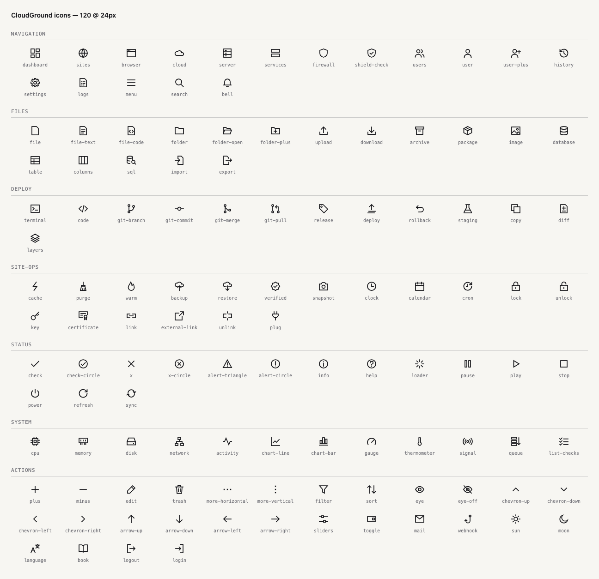
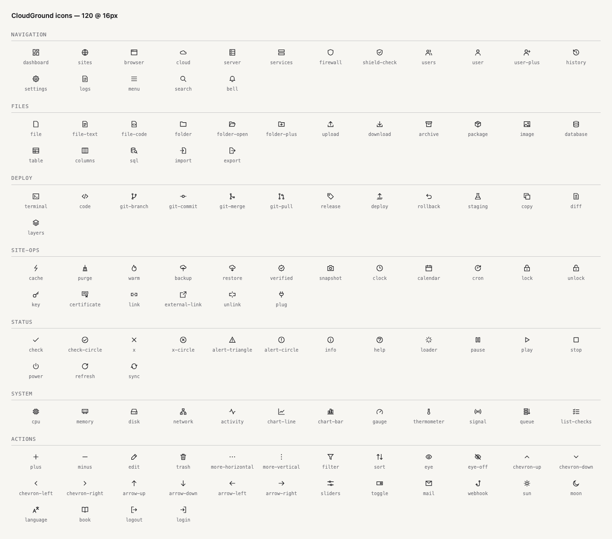

# CloudGround Icons

120 line icons drawn for the [CloudGround](https://cloudground.it) hosting panel: one stroke, square ends, sharp corners, on a 24 × 24 grid.

<picture>
  <source media="(prefers-color-scheme: dark)" srcset="preview/dark.png">
  
</picture>

## Use

Each icon is a standalone SVG in [`icons/`](icons). It draws in `currentColor`, so it takes the text colour around it:

```html

```

To style it with CSS, inline it instead:

```html
<span style="color: #2F5BFF">
  <!-- contents of icons/backup.svg -->
</span>
```

[`icons.json`](icons.json) lists every icon with its group, search tags and inner markup (`svg_inner`), for building a component or a sprite:

```json
{"name": "backup", "group": "site-ops", "tags": ["..."], "svg_inner": "<path d=\"...\"/>"}
```

Wrap `svg_inner` in the shared root element:

```html
<svg xmlns="http://www.w3.org/2000/svg" viewBox="0 0 24 24" fill="none"
     stroke="currentColor" stroke-width="1.75" stroke-linecap="square" stroke-linejoin="miter">
```

## Rules

Every icon follows the same rules, and `python3 scripts/validate.py` checks them on each push:

- 24 × 24 viewBox; the drawing stays inside 1–23.
- One stroke, 1.75 wide, square caps and miter joins. No rounded rectangles.
- Only `path`, `circle`, `rect` and `line`. No transforms, ids, classes or inline styles.
- The only filled shapes are small square dots (1.5–2.5): the dots of `info`, `alert-*`, `more-*` and the like.
- Documents share one cut-corner page and folders one tabbed shape. `cloud`, `backup` and `restore` use the cloud from the CloudGround logo.

They read at 16 px too:



## The set

- **Navigation** (17): `dashboard`, `sites`, `browser`, `cloud`, `server`, `services`, `firewall`, `shield-check`, `users`, `user`, `user-plus`, `history`, `settings`, `logs`, `menu`, `search`, `bell`
- **Files and data** (17): `file`, `file-text`, `file-code`, `folder`, `folder-open`, `folder-plus`, `upload`, `download`, `archive`, `package`, `image`, `database`, `table`, `columns`, `sql`, `import`, `export`
- **Deploy** (13): `terminal`, `code`, `git-branch`, `git-commit`, `git-merge`, `git-pull`, `release`, `deploy`, `rollback`, `staging`, `copy`, `diff`, `layers`
- **Site operations** (18): `cache`, `purge`, `warm`, `backup`, `restore`, `verified`, `snapshot`, `clock`, `calendar`, `cron`, `lock`, `unlock`, `key`, `certificate`, `link`, `external-link`, `unlink`, `plug`
- **Status** (15): `check`, `check-circle`, `x`, `x-circle`, `alert-triangle`, `alert-circle`, `info`, `help`, `loader`, `pause`, `play`, `stop`, `power`, `refresh`, `sync`
- **System** (12): `cpu`, `memory`, `disk`, `network`, `activity`, `chart-line`, `chart-bar`, `gauge`, `thermometer`, `signal`, `queue`, `list-checks`
- **Actions** (28): `plus`, `minus`, `edit`, `trash`, `more-horizontal`, `more-vertical`, `filter`, `sort`, `eye`, `eye-off`, `chevron-up`, `chevron-down`, `chevron-left`, `chevron-right`, `arrow-up`, `arrow-down`, `arrow-left`, `arrow-right`, `sliders`, `toggle`, `mail`, `webhook`, `sun`, `moon`, `language`, `book`, `logout`, `login`

## Licence

[MIT](LICENSE). Use them in anything, commercial or not; keep the licence notice with the files.
